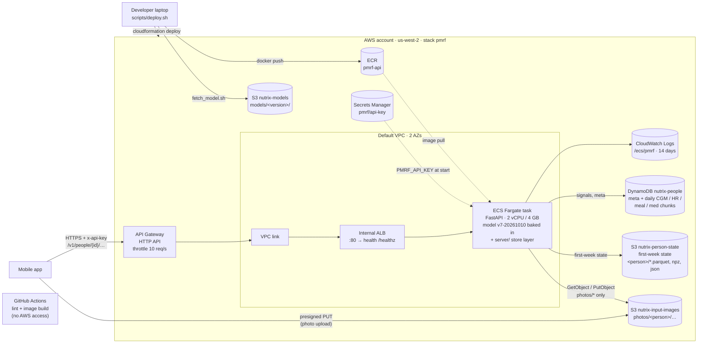

# Nutrix

Rutgers Health Hack 2026. Predicts a person's post-meal glucose curve from a meal photo, their recent CGM and heart rate,
and their first week of data (PMRF model).

## Deployment architecture

Live on AWS (us-west-2) as one CloudFormation stack (`infra/pmrf.yaml`), deployed with `scripts/deploy.sh`. Person data is on DynamoDB + S3. Request path, security boundaries and release steps: [docs/architecture.md](docs/architecture.md).



## Layout

| Path | What | Owner |
| --- | --- | --- |
| `mobile/` | Expo / React Native app (Clerk sign-in, see Authentication below) | App team |
| `services/clerk-role-webhook/` | Lambda that gives new sign-ups the Patient role | App team |
| `model/` | PMRF model code, FastAPI service, Dockerfile, model docs (`model/DEPLOY.md`, `model/docs/api_contract.md`). Synced from `feature/model`; do not edit here | Model team |
| `scripts/` | Build, test and deploy entry points | Deployment |
| `ops/data/` | Dataset sync with S3 and test-photo selection | Deployment |
| `tests/integration/` | Tests against a running service: day-8 meals of the onboarded patients (`day8_meals.csv`) and unseen hospital meal photos | Deployment |
| `docs/` | [API reference](docs/api.md), [deployment architecture](docs/architecture.md), [testing the deployed API](docs/testing_api.md) and notes: AWS account, buckets, model artifacts, decisions | Deployment |
| `infra/` | CloudFormation stack for the service (API Gateway, ALB, ECS Fargate, DynamoDB, S3) | Deployment |
| `server/` | AWS image layer: runs the model service with person data on DynamoDB + S3 (`model/` unchanged) | Deployment |
| `.github/workflows/` | CI: lint and image build, no AWS access | Deployment |

## Run the service locally

Needs the AWS CLI (profile `nutrix` with the event account's temporary credentials), Docker and Python 3.11.

```bash
pip install -r requirements.txt   # Python packages for the scripts and tests (the image installs its own subset)
cp .env.example .env              # set PMRF_API_KEY
set -a; . ./.env; set +a
./ops/data/sync_data.sh pull      # datasets -> data/ (integration tests use data/CGMacros)
./scripts/fetch_model.sh          # model files -> model/deploy/model_store/<version>, checksums verified
./scripts/build.sh                # image pmrf-api:<version>
docker run --rm --cpus 2 --memory 4g -p 8080:8080 -e PMRF_API_KEY pmrf-api:$MODEL_VERSION
curl localhost:8080/healthz
```

## Deploy to AWS

```bash
set -a; . ./.env; set +a          # AWS profile, model version, CLERK_JWT_ISSUER / CLERK_JWT_AUDIENCE (required)
./scripts/deploy.sh               # image -> ECR, CloudFormation stack create/update, waits for health checks, prints the API URL
python -I ops/data/onboard_patients.py <api-url> data/CGMacros <ids...>   # load CGMacros participants as cgmacros-<id>
```

`deploy.sh` tags the image with the model version and the git commit, so commit first. The first deploy takes about 10 minutes; a
release that fails its health checks rolls back automatically. `SKIP_BUILD=1` reuses a local model image.

A new AWS account needs, once: the model files in an S3 bucket (`scripts/fetch_model.sh` reads `s3://nutrix-models/models/<version>/`),
an S3 bucket for meal photos (template parameter `PhotoBucket`), and bucket names that are free (S3 names are global;
`nutrix-person-state` is set in `infra/pmrf.yaml`). Details: [docs/architecture.md](docs/architecture.md).

## Tests

Against the deployed API: [docs/testing_api.md](docs/testing_api.md).

```bash
./scripts/test.sh                                   # static checks (same as CI)
./scripts/test_integration.sh http://localhost:8080 # API flow + hospital meal photos
```

## Authentication

The Expo app in `mobile/` uses Clerk for email/password authentication and has three exclusive portal roles:

- `Patient` — public, self-service email/password registration.
- `Clinician` — invite-only account created by the Nutrix team.
- `Admin` — invite-only account created by the Nutrix team.

The Admin / Clinician / Patient selector is a portal check, not a way to choose access. An account that signs in through a different portal is immediately signed out and shown an authorization error.

### Mobile setup

1. In the Clerk Dashboard, enable **Native API** under **Native applications**.
2. Under **User & authentication**, enable **Email address**, **Password**, email-code verification, and first-name collection. First name is Nutrix's required display name.
3. Create `mobile/.env` locally (it is ignored by Git):

   ```env
   EXPO_PUBLIC_CLERK_PUBLISHABLE_KEY=pk_test_...
   ```

4. Start the app:

   ```bash
   cd mobile
   npm ci
   npx expo start
   ```

Only the Clerk publishable key belongs in the Expo app. Never put `CLERK_SECRET_KEY` in a mobile build, an `.env` file that is committed, or any client-side code.

### Provision an Admin or Clinician

Before giving a staff member access:

1. Create or invite their Clerk user from a trusted team process.
2. Set `publicMetadata.role` to exactly `admin` or `clinician` using the Clerk Dashboard/Backend API. Never allow the mobile client to write this value.
3. Verify the user can only enter through the matching Nutrix portal tab.
4. Configure Clerk's session-token customization to add the role claim used by the AWS API. The AWS service must verify the Clerk JWT and authorize its role claim; it must not trust a role sent in a request body.

Publicly registered users receive `publicMetadata.role: "patient"` through the trusted Clerk webhook in `services/clerk-role-webhook/`. The mobile app never writes public metadata. This makes the patient role visible in the Clerk Dashboard while preventing self-assignment of staff roles.

### Patient role webhook

Run `npm install && npm run build` in `services/clerk-role-webhook/`, then deploy its `dist/` directory with the production dependencies as a Node.js 20+ AWS Lambda. Set the Lambda handler to `index.handler` and expose it through a **Lambda Function URL** (public `POST` access is required for Clerk delivery). Configure these Lambda environment variables from secure secret storage, never from the Expo app:

- `CLERK_SECRET_KEY` — Clerk Backend API secret key.
- `CLERK_WEBHOOK_SIGNING_SECRET` — signing secret for this specific Clerk webhook endpoint.

In Clerk Dashboard, create a webhook endpoint using the Lambda Function URL and subscribe it to `user.created`. The handler verifies the Clerk signature, then writes `publicMetadata.role: "patient"` with Clerk's Backend API. It preserves a pre-existing `admin` or `clinician` role created by a trusted backend.

Webhook delivery is asynchronous. A just-created patient's role may appear in the Clerk Dashboard a moment after signup; the mobile app safely resolves an absent role as Patient during that brief interval.

For a staff account created manually in the Dashboard, the webhook initially assigns `patient`. Before sending the invitation, overwrite the role with exactly `admin` or `clinician`; the mobile app and future AWS API then treat that staff role as authoritative.

## AWS ML pipeline

The ML pipeline can stay in AWS independently of Clerk. The Expo app sends the Clerk session token as `Authorization: Bearer <token>` to the AWS API. API Gateway/Lambda must verify its JWT signature, issuer, audience/authorized party, expiry, and role claim before invoking a pipeline or accessing data.
