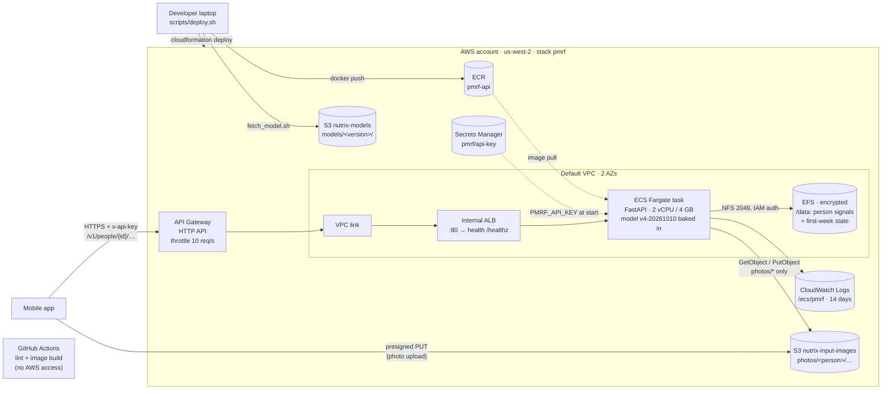

# nutrix

Rutgers Health Hack 2026. Predicts a person's post-meal glucose curve from a meal photo, their recent CGM and heart rate,
and their first week of data (PMRF model).

## Deployment architecture

Live on AWS (us-west-2) as one CloudFormation stack (`infra/pmrf.yaml`), deployed with `scripts/deploy.sh`. Request path, security boundaries and release steps: [docs/architecture.md](docs/architecture.md).



## Layout

| Path | What | Owner |
| --- | --- | --- |
| `mobile/` | Expo / React Native app | App team |
| `model/` | PMRF model code, FastAPI service, Dockerfile, model docs (`model/DEPLOY.md`, `model/docs/api_contract.md`). Synced from `feature/model`; do not edit here | Model team |
| `scripts/` | Build, test and deploy entry points | Deployment |
| `ops/data/` | Dataset sync with S3 and test-photo selection | Deployment |
| `tests/integration/` | Tests against a running service, incl. unseen hospital meal photos | Deployment |
| `docs/` | [Deployment architecture](docs/architecture.md) and notes: AWS account, buckets, model artifacts, decisions | Deployment |
| `infra/` | CloudFormation stack for the service (API Gateway, ALB, ECS Fargate, EFS) | Deployment |
| `.github/workflows/` | CI: lint and image build, no AWS access | Deployment |

## Run the service locally

Needs the AWS CLI (profile `nutrix`, see `docs/deployment_notes.md`), Docker and Python 3.11.

```bash
cp .env.example .env              # set PMRF_API_KEY
set -a; . ./.env; set +a
./ops/data/sync_data.sh pull      # datasets -> data/ (integration tests use data/CGMacros)
./scripts/fetch_model.sh          # model files -> model/deploy/model_store/<version>, checksums verified
./scripts/build.sh                # image pmrf-api:<version>
docker run --rm --cpus 2 --memory 4g -p 8080:8080 -e PMRF_API_KEY pmrf-api:$MODEL_VERSION
curl localhost:8080/healthz
```

## Tests

```bash
./scripts/test.sh                                   # static checks (same as CI)
./scripts/test_integration.sh http://localhost:8080 # API flow + hospital meal photos
```
