# Deployment architecture

The PMRF prediction service runs on AWS (us-west-2) as one CloudFormation stack, `infra/pmrf.yaml`, deployed with
`scripts/deploy.sh`. The design follows `model/DEPLOY.md`.

```mermaid
flowchart LR
    app["Mobile app"]
    dev["Developer laptop<br/>scripts/deploy.sh"]
    gh["GitHub Actions<br/>lint + image build<br/>(no AWS access)"]

    subgraph aws["AWS account · us-west-2 · stack pmrf"]
        apigw["API Gateway<br/>HTTP API<br/>throttle 10 req/s"]
        secret[("Secrets Manager<br/>pmrf/api-key")]
        ecr[("ECR<br/>pmrf-api")]
        logs[("CloudWatch Logs<br/>/ecs/pmrf · 14 days")]

        subgraph vpc["Default VPC · 2 AZs"]
            link["VPC link"]
            alb["Internal ALB<br/>:80 → health /healthz"]
            task["ECS Fargate task<br/>FastAPI · 2 vCPU / 4 GB<br/>model v4-20261010 baked in"]
            efs[("EFS · encrypted<br/>/data: person signals<br/>+ first-week state")]
        end

        photos[("S3 nutrix-input-images<br/>photos/&lt;person&gt;/…")]
        models[("S3 nutrix-models<br/>models/&lt;version&gt;/")]
    end

    app -- "HTTPS + x-api-key<br/>/v1/people/{id}/…" --> apigw
    app -- "presigned PUT<br/>(photo upload)" --> photos
    apigw --> link --> alb --> task
    task -- "NFS 2049, IAM auth" --> efs
    task -- "GetObject / PutObject<br/>photos/* only" --> photos
    task --> logs
    secret -. "PMRF_API_KEY at start" .-> task
    ecr -. "image pull" .-> task
    dev -- "docker push" --> ecr
    dev -- "fetch_model.sh" --> models
    dev -- "cloudformation deploy" --> aws
```

## Request path

1. The app asks the service for a presigned URL (`POST /v1/people/{id}/photos/upload-url`) and uploads the meal photo
   straight to S3; the photo never passes through API Gateway.
2. The app calls `POST /v1/people/{id}/predict` with the photo key and meal time. API Gateway forwards it over the
   VPC link to the internal ALB, which sends it to a Fargate task.
3. The task reads the photo from S3 and the person's first-week state and recent CGM from EFS, runs the model and
   returns the predicted glucose curve.

## Security boundaries

| From | To | Allowed |
| --- | --- | --- |
| Internet | ALB, tasks, EFS | Nothing: the ALB is internal; only API Gateway reaches it through the VPC link |
| VPC link | ALB | TCP 80 |
| ALB | Tasks | TCP 8080 |
| Tasks | EFS | TCP 2049, through one access point (uid 10001) with IAM authorization |
| Tasks | S3 | `s3:GetObject`, `s3:PutObject` on `nutrix-input-images/photos/*` only |

The API key is generated by Secrets Manager and injected into the container at start; it is not in git, the image or
the logs. The service never logs glucose values or photos.

## Deploying and releasing

| Action | How |
| --- | --- |
| Deploy or update | `./scripts/deploy.sh` builds the image, pushes it to ECR as `<model version>-<git sha>`, updates the stack and waits for the new task to pass health checks. A failed rollout rolls back automatically (ECS deployment circuit breaker) |
| New model version | Upload it to `s3://nutrix-models/models/<version>/`, then `./scripts/deploy.sh <version>` |
| CI | GitHub Actions runs lint and a Docker build on pull requests; it has no AWS credentials (the event account's credentials are temporary) |
| Tear down | `aws cloudformation delete-stack --stack-name pmrf` removes everything above except the S3 buckets and the ECR repository |
